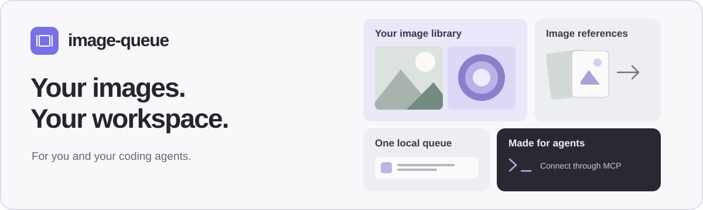
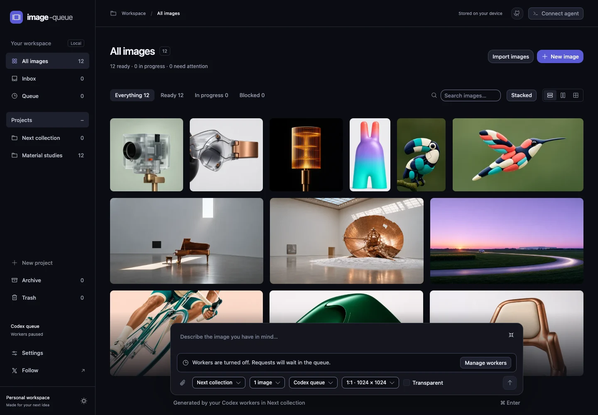
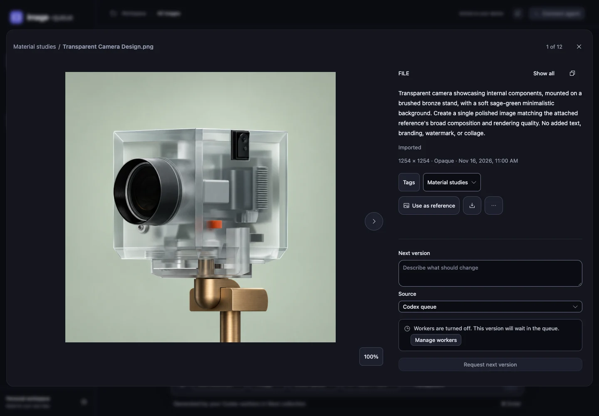

# image-queue: local AI image generation queue and gallery

<p>
  
</p>

[](LICENSE)
[](#install)
[](#connect-your-coding-agent-mcp)
[](#install)
[](SECURITY.md)

**Generate AI images with your Codex plan or an OpenAI API key, and keep every prompt, reference and version in one local gallery.** image-queue runs on your machine, saves images to your own folders, and lets coding agents request images through MCP.



## Install

Requires **Node.js 24+** and **pnpm 10.28.2**. Tested on **macOS (Apple silicon) only**. Linux, Windows and Intel Macs are untested and not supported yet. Local Codex execution also requires **Codex CLI 0.167.1+**, signed in with ChatGPT. Version 0.167.1 is the tested baseline.

```sh
git clone https://github.com/corgicorner/image-queue.git
cd image-queue
pnpm install --frozen-lockfile
pnpm build
pnpm start
```

Then:

1. Open [http://127.0.0.1:3215](http://127.0.0.1:3215).
2. Create a project.
3. In **Settings**, add your OpenAI API key, or choose **Resume** in **Codex queue** for your signed-in Codex installation.
4. Write a prompt and generate.

Prefer to let an agent do it? See [Set up with an agent](#set-up-with-an-agent).

## Two ways to generate images

| | OpenAI API key | Codex plan |
| --- | --- | --- |
| Best for | The fastest start | Using the access you already pay for |
| Setup | Paste a key in Settings | [Set up local Codex execution](docs/codex-workers.md) |
| How it works | Your prompt goes straight to the image model | A local executor sends each request to Codex |
| Cost | Billed by OpenAI per image | Included in your plan, within its limits |

**ChatGPT Pro or Business subscriber?** You may have monthly API credits you can spend on image generation. [Claim them](https://developers.openai.com/api/docs/guides/chatgpt-api-credits), then create a key in the linked organization. Unused credits expire each billing cycle.

## How the queue works

Add a request and image-queue starts it as soon as a slot is free, up to the **Parallel requests** limit. Keep the image-queue server running and your Mac awake while generating. Sleep suspends local execution; closing the server or shutting down the Mac stops it. The browser tab can be closed. An empty queue does not wake the model. **Pause** stops new requests and lets running images finish. If a verified plan limit is reached, waiting requests resume after its reset. Interrupted generations need your review before retrying.

No cron setup is needed for local execution. The older scheduled Codex chats remain an advanced compatibility option; see [Codex workers](docs/codex-workers.md).

## What you get

- **A local gallery.** Images, prompts and references stay in project folders on your disk.
- **A queue.** Requests wait safely while workers are offline.
- **Reference image editing.** Drop a PNG, JPEG or WebP into the prompt, or open a result and use **Next version**.
- **Version stacks.** Every revision stays next to the image it came from.
- **Agent access.** Any MCP client can request images and get file paths back.



## Connect your coding agent (MCP)

```sh
pnpm build:mcp
```

Copy the MCP configuration from **Settings** into Claude Code, Codex or another MCP client. The agent can then request images and read results as local file paths.

### Set up with an agent

Give a local agent terminal access to the folder where you want image-queue, then paste:

```text
Set up https://github.com/corgicorner/image-queue in this folder.
Read its README and AGENTS.md. Check Node.js 24+ and pnpm, install, build the app
and the MCP server, and start the dashboard on loopback. Add the local MCP
configuration to this agent and verify list_projects. Keep any existing projects,
queue and credentials. I will enter my API key in Settings myself.
```

## FAQ

### Can I generate images with my existing Codex plan?

Yes. Follow the [Codex worker setup](docs/codex-workers.md) and choose **Codex queue** in the prompt editor. The application must stay running. Choose **Resume** in Settings to start the local executor. **Parallel requests** sets how many images can run at once; **Pause** preserves that setting. Availability and limits depend on your account. See [current Codex limits](https://help.openai.com/en/articles/11369540-using-codex-with-your-chatgpt-plan).

### Is image-queue free?

The software is free and open source. Generation is not unlimited: the Codex queue uses your plan's allowance, and API usage is billed by OpenAI unless credits cover it.

### How do I edit an image from a reference?

Drop an image into the prompt editor and describe the change. To revise a result, open it and use **Next version**. Each request is a new image, not a chat, so write the full instruction.

### Where are my images and keys stored?

Images and references live in your project folders. API keys are kept in the macOS Keychain or a private credential file. Only the prompt and the references you attach are sent to the provider.

## Current limits

Version 0.1.0 supports local deployment on macOS (Apple silicon). Cloudflare deployment is experimental and outside this release.

- Tested on macOS (Apple silicon) only. Codex queue and Keychain storage have not been verified on other platforms.
- Tested models: GPT Image 2.6 Flare and GPT Image 1.5, at 1024 × 1024, with reference editing.
- Only models with a verified size profile appear in the model list.
- References: PNG, JPEG or WebP, up to 20 MB.
- Interrupted paid requests are not retried automatically.
- Not included yet: multi-machine sync, video, Windows and Linux support.
- Some OpenAI accounts need [organization verification](https://developers.openai.com/api/docs/guides/image-generation) before using image models.

## More

[Configuration](docs/configuration.md) · [Codex workers](docs/codex-workers.md) · [Contributing](CONTRIBUTING.md) · [Security](SECURITY.md)

Licensed under [Apache 2.0](LICENSE).
